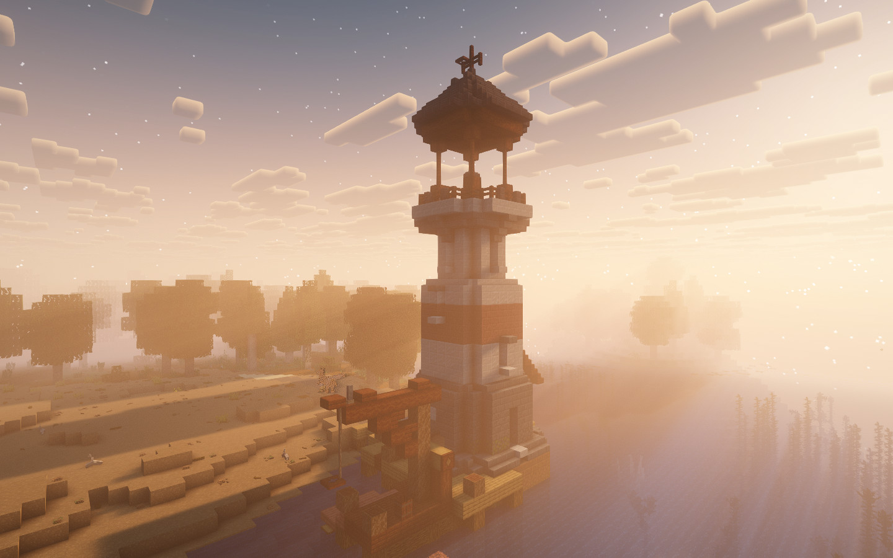

<h1> Grodion's Four Winds Roadworks</h1>

[По-русски](README.ru.md) · [Screenshot gallery](docs/gallery/README.md) · [Contributing](CONTRIBUTING.md)

Four roads meet near the centre of the Overworld. Pick a direction and the paving gives way to gravel, a turning for a village, or a flight of steps cut into the hillside. Where a road reaches a sheltered coast, you might find a working pier and a lighthouse with stairs all the way up to the beacon.

The main roads run five blocks wide. A four-block gravel lane has room for two wheel tracks. The last few blocks into a village are often just a three-block dirt track. Wooden signs at crossroads carry the compass directions. At a village turning, the sign gives the destination and the distance.

Short river crossings can have a timber deck or a stone arch. In the mountains, the road can pass under a rock gallery or through a supported tunnel. Along quieter stretches there are occasional roofed benches and mounting stones.

### Playing

Use **Minecraft Java 1.21.1** with **NeoForge 21.1.267**. Put the mod JAR in `mods/` on the client and on the server. Explore new chunks in the Overworld to find the roads. In an existing save, start beyond the area you have already explored.

TerraFirmaCraft is optional. In its Overworld preset, the roads pick up the local soil and stone, the quays use TFC timber and the beacon burns fuel in a TFC firepit. Village turnings depend on which settlements your world can generate.

### Building

Install JDK 21 and run `./gradlew build` on Linux or macOS, or `.\gradlew.bat build` on Windows. The finished JAR is in `build/libs/`. [Build history](https://github.com/grodionn/four-winds-roadworks/actions/workflows/build.yml)

For a development client, editable models and reproducible worldgen checks, see [Contributing](CONTRIBUTING.md). If you find a broken stretch, a seed, coordinates and a screenshot make a good [bug report](https://github.com/grodionn/four-winds-roadworks/issues/new/choose).
