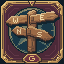
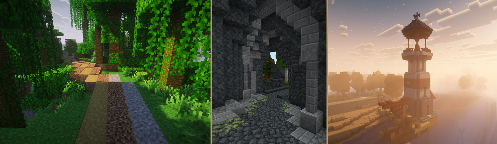

<h1> Grodion's Four Winds Roadworks</h1>

[Установка](#как-играть) · [Галерея](docs/gallery/README.ru.md) · [Сообщить о проблеме](https://github.com/grodionn/four-winds-roadworks/issues/new/choose) · [Работа над модом](CONTRIBUTING.md) · [English](README.md)

Около центра Верхнего мира сходятся четыре тракта. По одному можно выйти к деревне, по другому спуститься к морю. Если берег подходит для причала, дорога заканчивается у деревянной пристани. Иногда рядом стоит маяк. На его верхнюю галерею можно подняться по лестнице из комнаты смотрителя.

Ширина главного тракта — пять блоков. На просёлке в четыре блока видны две гравийные колеи. Последний поворот к деревне бывает уже совсем узким, в три блока. На перекрёстках деревянные стрелки показывают стороны света, а у отворота к поселению — куда идти и сколько ещё до него.

На реках встречаются деревянные мосты и каменные арки. В горах дорога уходит под скальную галерею или в тоннель с опорами. Иногда на сухой обочине попадается навес с лавкой или каменная ступень, с которой удобно сесть в седло.

### Как играть

Для **1.21.1, 1.20.1, 1.19.2, 1.18.2 и 1.16.5** есть сборки под Forge и Fabric. На **1.12.2** подойдут Forge или Legacy Fabric. На **1.21.1** также доступен NeoForge. Для Fabric на 1.16.5 и новее нужен Fabric API. Его версию и проверенные сочетания с TFC можно найти в [таблице совместимости](ports/README.md).

Опубликованные версии можно скачать в разделе [Releases](https://github.com/grodionn/four-winds-roadworks/releases). Чтобы попробовать сборку из `main`, войдите в GitHub, откройте [сборку с зелёной галочкой](https://github.com/grodionn/four-winds-roadworks/actions/workflows/build.yml?query=branch%3Amain+is%3Asuccess) и в разделе **Artifacts** скачайте архив для своей версии Minecraft и загрузчика. Распакуйте JAR и положите его в папку `mods` на клиенте и сервере. В существующем мире дороги появятся в новых чанках Верхнего мира.

В обычном мире используются ванильные материалы. В пресете TerraFirmaCraft тракты проложены из местного грунта и камня, для причалов используется древесина TFC, а огонь на маяке можно заново разжечь в очаге. Отвороты к поселениям зависят от того, какие деревни генерируются в вашей сборке. На 1.12.2 в TFC Classic каменную часть тракта кладут из андезита.

### Как собрать и предложить правку

Для сборки под NeoForge 1.21.1 установите JDK 21. В корне проекта выполните `.\gradlew.bat build` в Windows или `./gradlew build` в Linux и macOS. Готовый мод появится в `build/libs/`. [История сборок](https://github.com/grodionn/four-winds-roadworks/actions/workflows/build.yml)

- **Нашли баг.** Откройте [Issues](https://github.com/grodionn/four-winds-roadworks/issues/new/choose). Для генерации пригодятся версия мода, сид, координаты и скриншот с дороги. Можно писать по-русски.
- **Хотите исправить.** Нажмите **Fork**, склонируйте свою копию и создайте ветку, например `git switch -c fix/bridge-landing`. После проверки отправьте ветку в свой форк и откройте **Pull request** в `grodionn/four-winds-roadworks:main`.
- **Принимаете чужую правку.** В PR откройте **Files changed**, посмотрите изменения и кадры из игры. Результат сборки виден во вкладке **Checks**. Если проверка GitHub недоступна, соберите ветку локально и укажите результат в PR. После проверки нажмите **Squash and merge**, чтобы перенести правку в `main` одним коммитом.

[Инструкция для разработки и координаты проверочных миров](CONTRIBUTING.md)

Код и оригинальная графика доступны по [лицензии MIT](LICENSE).
