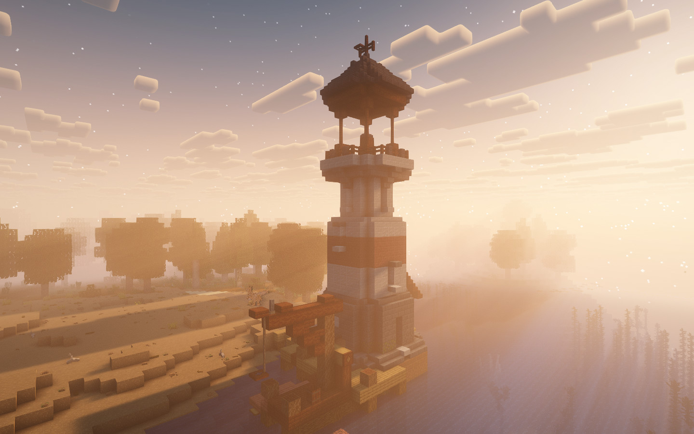

<h1> Grodion's Four Winds Roadworks</h1>

[English](README.md) · [Галерея](docs/gallery/README.ru.md) · [Работа над модом](CONTRIBUTING.md)

Около центра Верхнего мира сходятся четыре тракта. По одному можно выйти к деревне, по другому спуститься к морю. Если берег подходит для причала, дорога заканчивается у деревянной пристани. Иногда рядом стоит маяк. На его верхнюю галерею можно подняться по лестнице из комнаты смотрителя.

Ширина главного тракта — пять блоков. На просёлке в четыре блока видны две гравийные колеи. Последний поворот к деревне бывает уже совсем узким, в три блока. На перекрёстках деревянные стрелки показывают стороны света, а у отворота к поселению — куда идти и сколько ещё до него.

На реках встречаются деревянные мосты и каменные арки. В горах дорога уходит под скальную галерею или в тоннель с опорами. Иногда на сухой обочине попадается навес с лавкой или каменная ступень, с которой удобно сесть в седло.

### Как играть

Нужны **Minecraft Java 1.21.1** и **NeoForge 21.1.267**. Положите JAR в папку `mods` клиента и сервера. В существующем мире дороги появятся за пределами уже исследованных чанков Верхнего мира.

В обычном мире используются ванильные материалы. В пресете TerraFirmaCraft тракты проложены из местного грунта и камня, для причалов используется древесина TFC, а огонь на маяке можно заново разжечь в очаге. Отвороты к поселениям зависят от того, какие деревни генерируются в вашей сборке.

### Как собрать и предложить правку

Установите JDK 21. В корне проекта выполните `.\gradlew.bat build` в Windows или `./gradlew build` в Linux и macOS. Готовый мод появится в `build/libs/`. [История сборок](https://github.com/grodionn/four-winds-roadworks/actions/workflows/build.yml)

- **Нашли баг.** Откройте [Issues](https://github.com/grodionn/four-winds-roadworks/issues/new/choose). Для генерации пригодятся версия мода, сид, координаты и скриншот с дороги. Можно писать по-русски.
- **Хотите исправить.** Нажмите **Fork**, склонируйте свою копию и создайте ветку, например `git switch -c fix/bridge-landing`. После проверки отправьте ветку в свой форк и откройте **Pull request** в `grodionn/four-winds-roadworks:main`.
- **Принимаете чужую правку.** В PR откройте **Files changed**, посмотрите изменения и кадры из игры. Результат сборки виден во вкладке **Checks**. Если проверка GitHub недоступна, соберите ветку локально и укажите результат в PR. После проверки нажмите **Squash and merge**, чтобы перенести правку в `main` одним коммитом.

[Инструкция для разработки и координаты проверочных миров](CONTRIBUTING.md)
