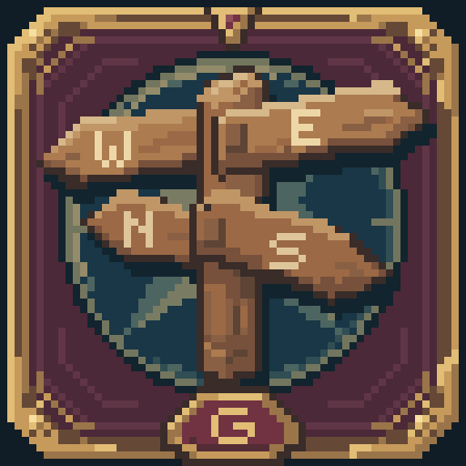

# Grodion's mod covers

Four Winds uses a field atlas as its cover. The oak waypost sits over a compass set into the oxblood leather. The [64 × 64 original](four-winds.ora) opens in Krita or GIMP. The dial, boards, post, lettering, shadow, binding and fittings can each be edited separately.

For another Grodion's mod, place the [transparent brass frame](cover-frame.png) on top of a 64 × 64 canvas. It includes the clipped corners and the enamel G plate. Use `#4C2938` for the leather surround and leave a few pixels between the subject and the brass. Choose a centrepiece from the new mod, as Four Winds uses its four-way sign.

Export the [in-game PNG](../src/main/resources/four-winds.png) at native size. The 512 × 512 preview is also the project avatar for CurseForge. Each source pixel occupies an 8 × 8 square.

The [page header](road-to-coast.jpg) puts three game screenshots side by side. Its panels come from [the jungle lane](../docs/gallery/jungle-lane.jpg), [the stone tunnel](../docs/gallery/stone-tunnel.jpg) and [the harbour](../docs/gallery/harbour.jpg). The narrow brass dividers pick up the colour of the cover frame. Captions and links stay in the page text so they can be read at any screen size.
