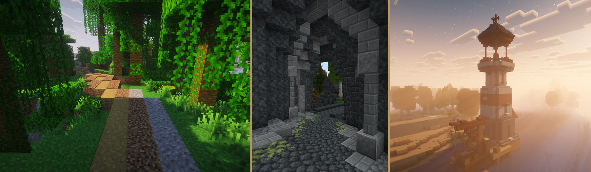

Four old roads meet near the centre of the Overworld. Follow the paving into the hills or take a gravel lane towards a village. At the turning, a wooden sign tells you which way to go and how many blocks you have left.

The main routes run five blocks wide. Country lanes narrow to four, and the last stretch into a village can be a three-block dirt track. A river crossing may have a timber deck or a stone arch. In the mountains, look for the daylight between the supports of a tunnel. On quieter stretches you might pass a roofed bench or a mounting stone.

At a sheltered coast the road can end at a wooden pier. Some have a lighthouse with a staircase from the keeper's room to the beacon. [See the nine in-game photographs, with seeds and camera positions.](https://github.com/grodionn/four-winds-roadworks/blob/main/docs/gallery/README.md)

### Installation

Choose the file for your Minecraft version and loader. Install it on the client and server, then explore new Overworld chunks.

- **1.21.1** supports NeoForge, Forge and Fabric.
- **1.20.1, 1.19.2, 1.18.2 and 1.16.5** support Forge and Fabric.
- **1.12.2** supports Forge and Legacy Fabric generation 1.

Fabric builds for 1.16.5 and later need Fabric API. TerraFirmaCraft is optional. Its roads and piers use TFC materials on Forge 1.12.2, 1.18.2 and 1.20.1 and on NeoForge 1.21.1. [Tested loader and dependency versions](https://github.com/grodionn/four-winds-roadworks/blob/main/ports/README.md)

### Help with Four Winds

A seed, coordinates and a view from the road help us reproduce a bad crossing. To help with a translation, a field test or code, see the contributor guide. Modpacks and forks are welcome under the MIT licence.

[Report a problem](https://github.com/grodionn/four-winds-roadworks/issues/new/choose) · [Contribute](https://github.com/grodionn/four-winds-roadworks/blob/main/CONTRIBUTING.md) · [MIT licence](https://github.com/grodionn/four-winds-roadworks/blob/main/LICENSE)
