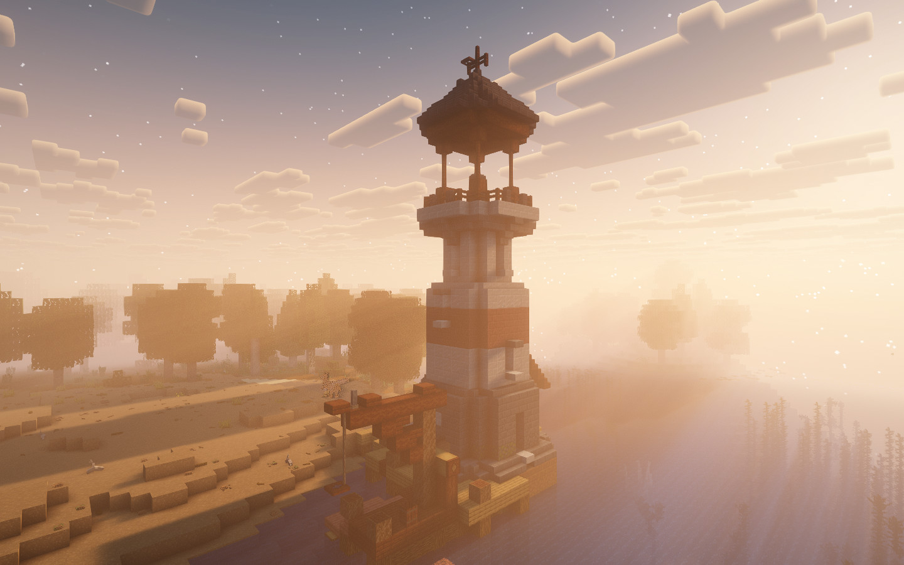
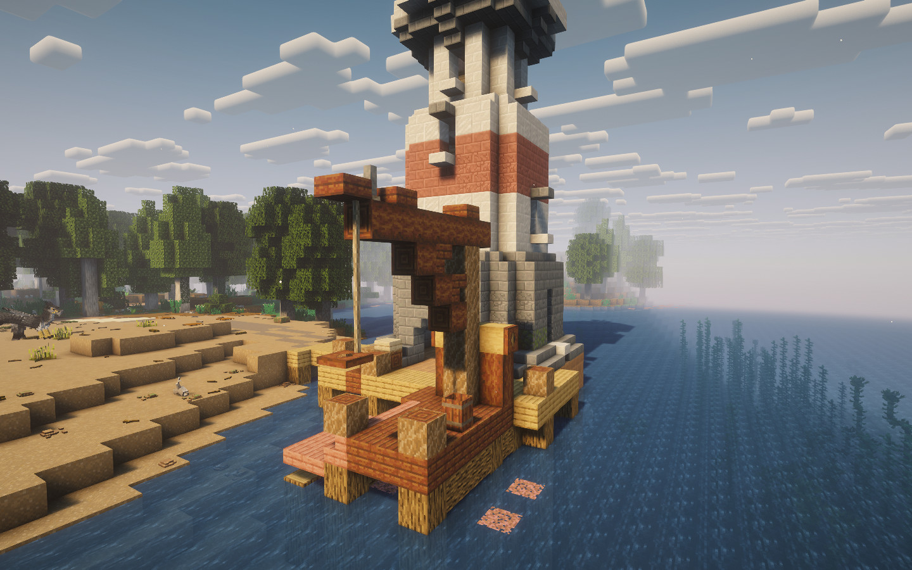
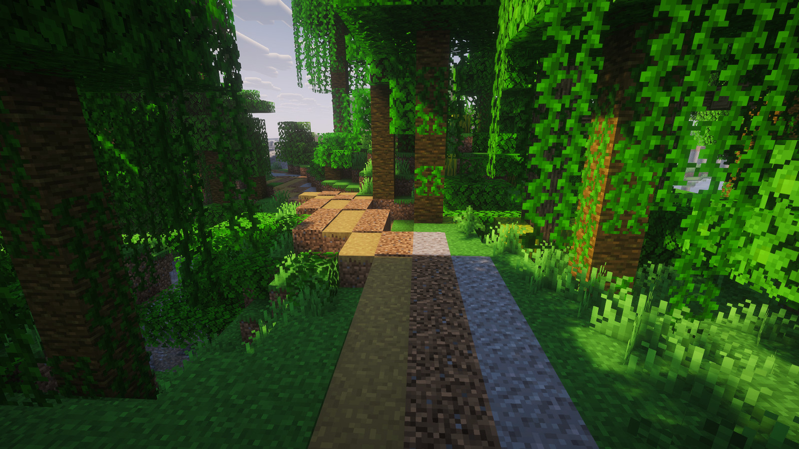
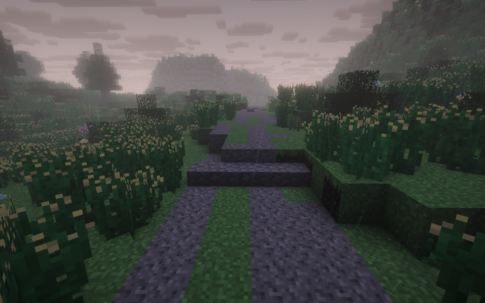
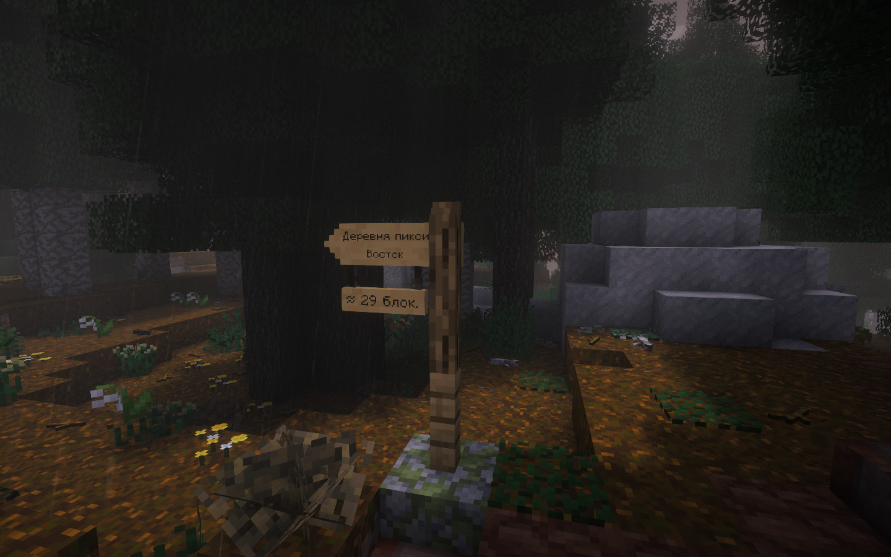
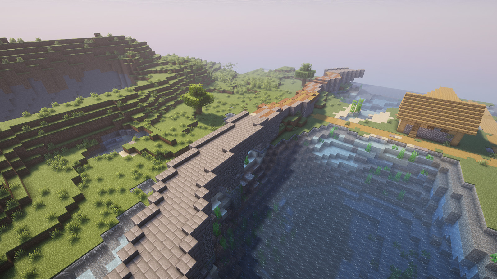
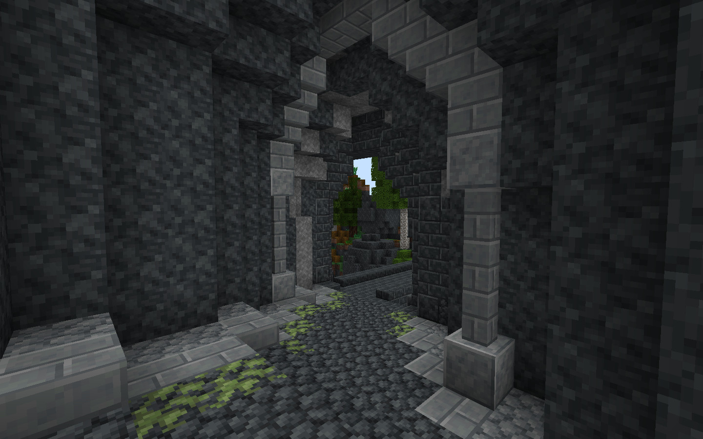
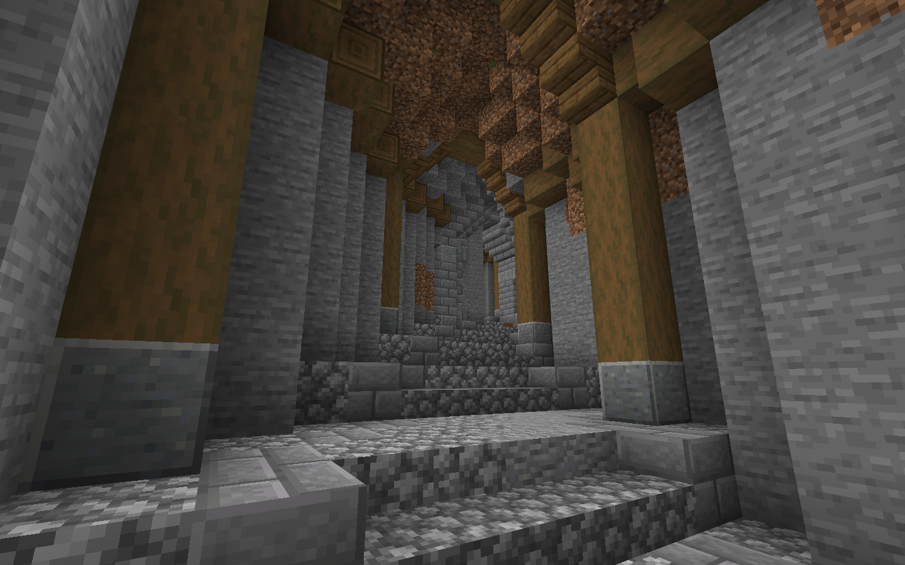
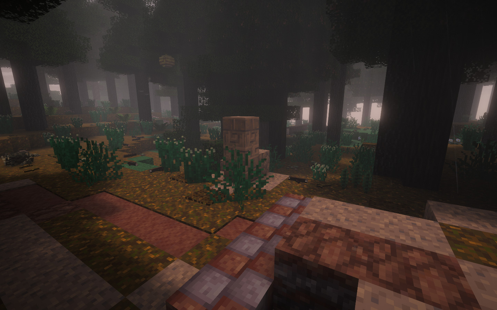

# Screenshot gallery

[Back to the mod](../../README.md) · [По-русски](README.ru.md)

Nine in-game photographs from Minecraft Java 1.21.1, taken during development before the first public release, 0.1.0. Each caption records the internal build number, seed and camera coordinates from that save. Road alignments can change between builds.

## At the coast

**The beacon at sunset.** The last light catches the roof above the lantern gallery. Below it, the quay wraps around the tower at the end of the road.

*TerraFirmaCraft · Four Winds 1.4.0 · seed `20261121` · XYZ `2467, 77, 963` · Complementary Reimagined*

**Along the quay.** The loading crane and its timber frame stand over the water. The road comes in behind the keeper’s shed.

*TerraFirmaCraft · Four Winds 1.4.0 · seed `20261121` · XYZ `2464, 68, 976` · Complementary Reimagined*

## Village roads

**A bend under the canopy.** The gravel disappears around the next tree, then comes back into the light on the far side of the bend.

*Vanilla · Four Winds 1.8.2 · seed `38473917` · XYZ `1372, 69, -2366` · Complementary Reimagined*

**Wheel tracks in the meadow.** Two gravel tracks run through the flowers with a strip of grass between them.

*TerraFirmaCraft · Four Winds 1.6.2 · seed `20261121` · XYZ `4117, 67, -1395` · Complementary Reimagined*

**The turn for the pixie village.** At this turning, the oak sign gives the distance to an Ice and Fire settlement among the TFC trees.

*TerraFirmaCraft + Ice and Fire · Four Winds 1.6.2 · seed `20261121` · XYZ `4217, 70, -603` · Complementary Reimagined*

## Crossings and cuttings

**The village floodplain.** From the riverbank you can see the stone road cross the water and turn towards the roofs on the far shore.

*Vanilla · Four Winds 1.8.2 · seed `38473917` · XYZ `397, 81, 721` · Complementary Reimagined*

**Daylight between the arches.** Stone ribs mark the way through the ridge. The pale opening between the last two piers is the far end of the tunnel.

*TerraFirmaCraft · Four Winds 1.8.0 · seed `7319041` · XYZ `-984, 75, -521`*

**Timber frames on the climb.** The lane climbs on cobbled steps. The beams run along the rock above the shoulders of the road.

*Vanilla · Four Winds 1.8.0 · seed `96320157` · XYZ `-627, 81, 165`*

## By the roadside

**A mounting stone in the forest.** A stone step stands off the paved road, in a clearing just wide enough to bring a horse alongside.

*TerraFirmaCraft · Four Winds 1.7.0 · seed `20261121` · XYZ `2449, 68, 1491` · Complementary Reimagined*
