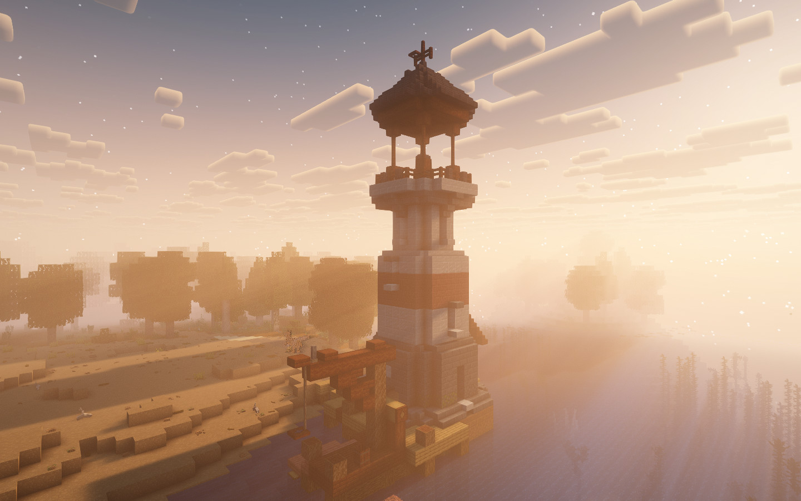
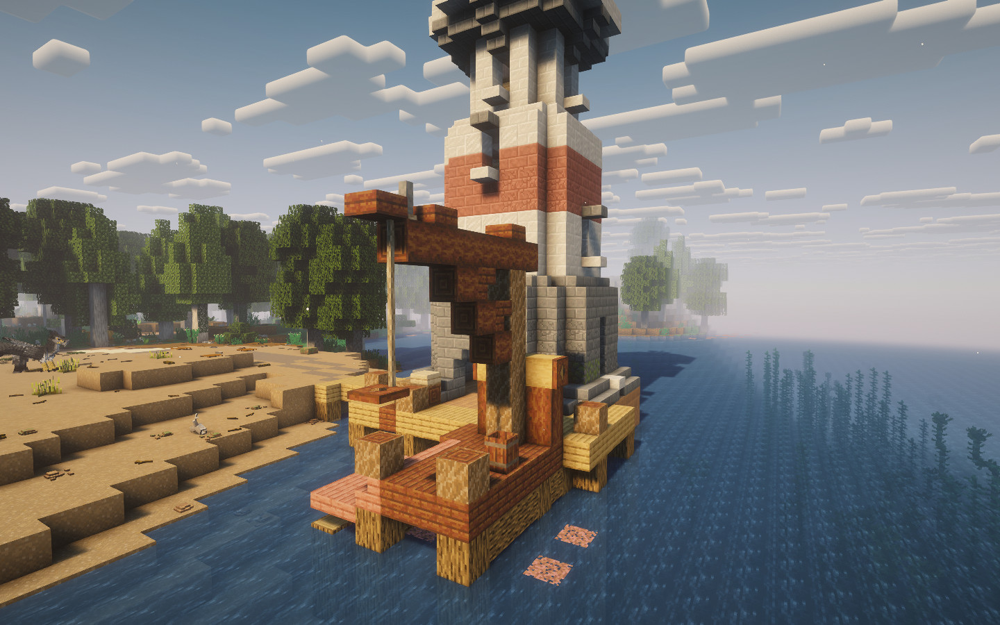
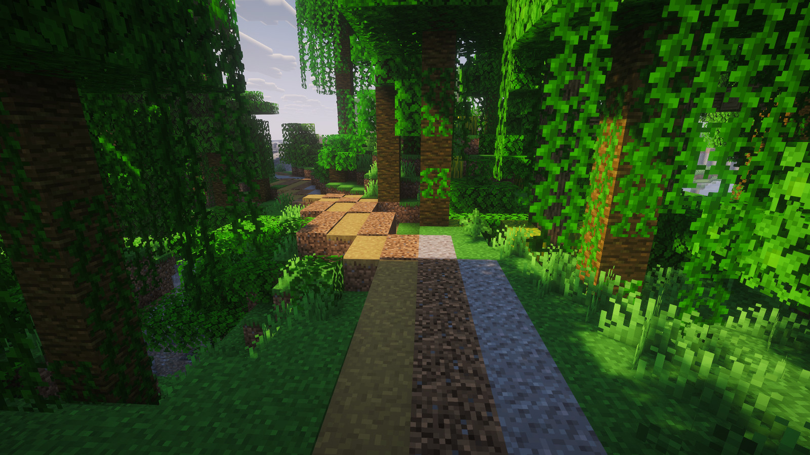
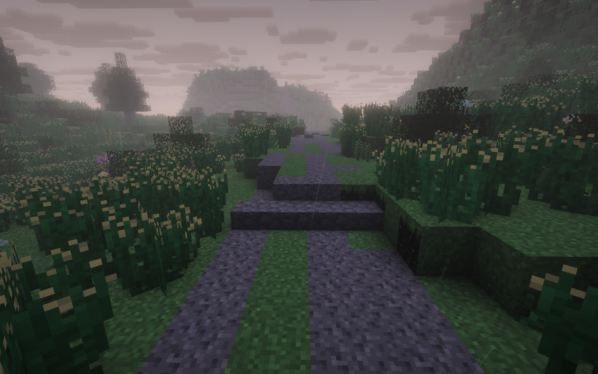
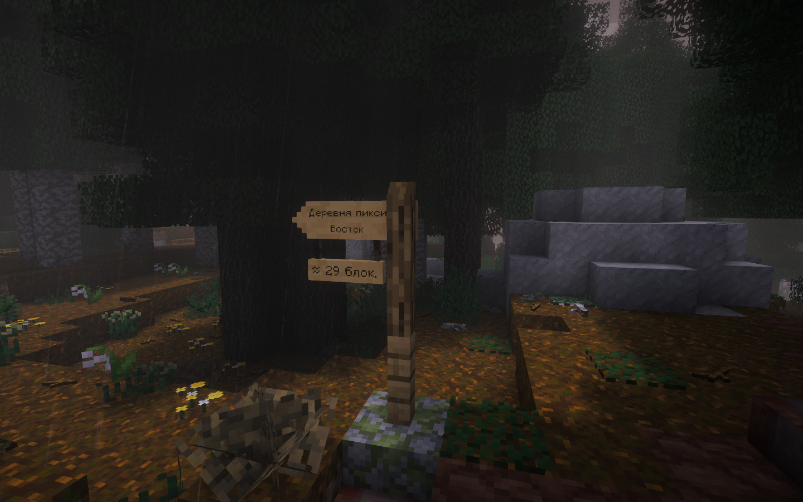
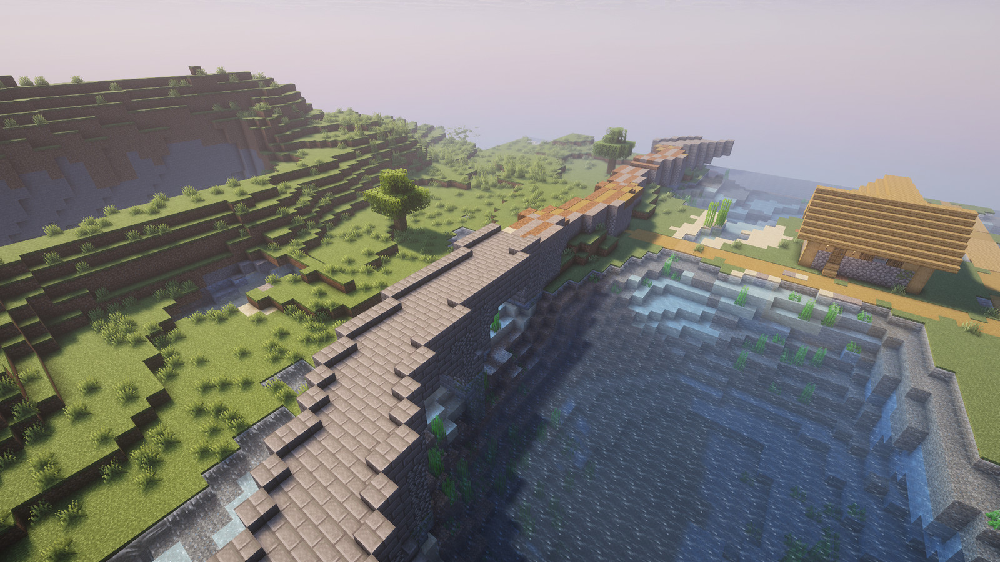
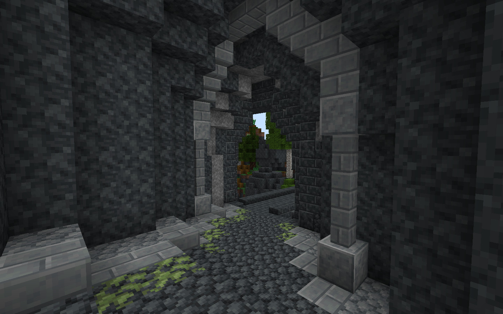
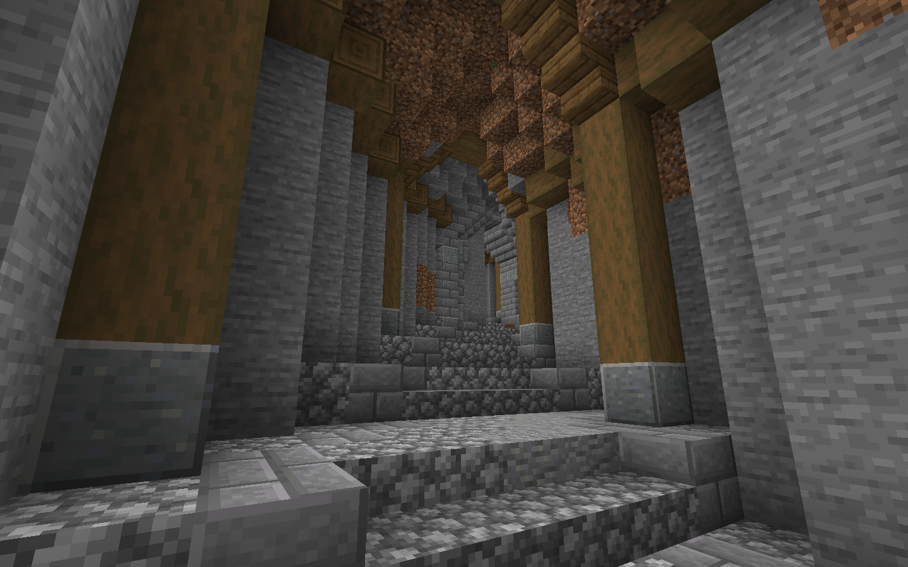
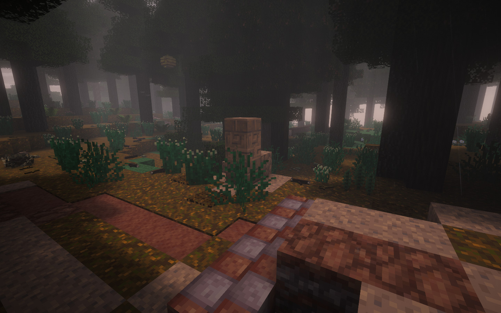

# Галерея

[К описанию мода](../../README.ru.md) · [English](README.md)

Девять кадров из Minecraft Java 1.21.1, снятых во время разработки до первого публичного релиза 0.1.0. Под каждым снимком указаны номер внутренней сборки, сид и координаты камеры в том сохранении. В другой сборке дорога на том же сиде может пройти иначе.

## На побережье

**Маяк на закате.** Последний свет ложится на крышу над верхней галереей. Внизу дорога выходит к причалу, который огибает каменное основание башни.

*TerraFirmaCraft · Four Winds 1.4.0 · сид `20261121` · XYZ `2467, 77, 963` · Complementary Reimagined*

**У причала.** Грузовая стрела вынесена над водой. С берега дорога подходит к пристани за кладовой смотрителя.

*TerraFirmaCraft · Four Winds 1.4.0 · сид `20261121` · XYZ `2464, 68, 976` · Complementary Reimagined*

## Тракты и просёлки

**Поворот в джунглях.** За стволом дорога ненадолго уходит в тень. На повороте её снова выдаёт светлая полоса гравия.

*Ванильная генерация · Four Winds 1.8.2 · сид `38473917` · XYZ `1372, 69, -2366` · Complementary Reimagined*

**Колеи на лугу.** Между двумя гравийными колеями осталась полоса травы. По краям просёлка цветёт луг.

*TerraFirmaCraft · Four Winds 1.6.2 · сид `20261121` · XYZ `4117, 67, -1395` · Complementary Reimagined*

**Отворот к деревне пикси.** Указатель на опушке показывает, сколько осталось до поселения пикси из Ice and Fire. В этой сборке деревня стоит прямо в лесу TFC.

*TerraFirmaCraft + Ice and Fire · Four Winds 1.6.2 · сид `20261121` · XYZ `4217, 70, -603` · Complementary Reimagined*

## Мосты и тоннели

**Дорога через пойму.** С берега видно, как каменный мост пересекает реку, а за ним дорога поворачивает к домам деревни.

*Ванильная генерация · Four Winds 1.8.2 · сид `38473917` · XYZ `397, 81, 721` · Complementary Reimagined*

**Свет между арками.** Каменные арки идут одна за другой под гребнем. В просвете между дальними опорами уже виден выход.

*TerraFirmaCraft · Four Winds 1.8.0 · сид `7319041` · XYZ `-984, 75, -521`*

**Деревянные рамы на подъёме.** Дорога поднимается по булыжным ступеням. Над обочинами на высоких деревянных стойках лежат продольные балки.

*Ванильная генерация · Four Winds 1.8.0 · сид `96320157` · XYZ `-627, 81, 165`*

## У обочины

**Ступень для всадника.** Рядом с мощёной дорогой видна каменная ступень. На маленькой площадке между деревьями можно поставить лошадь боком к камню.

*TerraFirmaCraft · Four Winds 1.7.0 · сид `20261121` · XYZ `2449, 68, 1491` · Complementary Reimagined*
